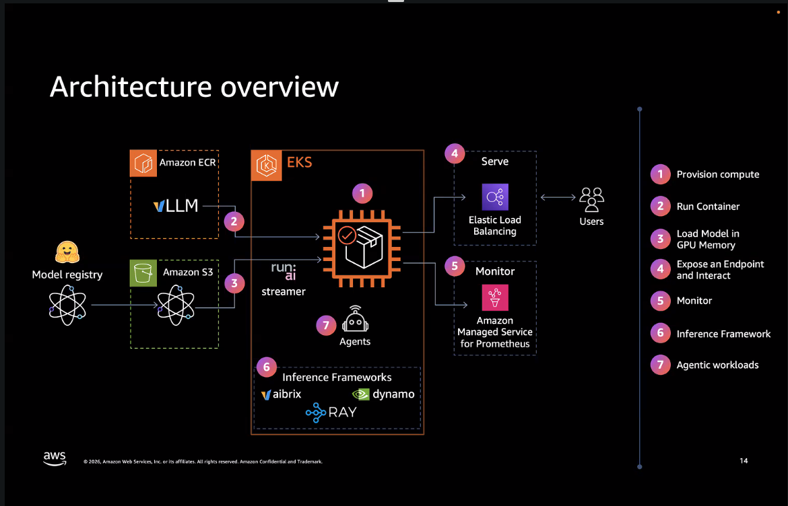

# GenAI on Amazon EKS — full reproduction, gotchas, and cost breakdown

A complete, scripted reproduction of AWS's hands-on workshop **"Building and Scaling GenAI Workloads with Amazon EKS"** (catalog title: *Generative AI on Amazon EKS using NVIDIA GPU*, complexity 400) — plus everything the workshop *doesn't* tell you: the exact failure modes hit along the way, a real cost estimate, and a from-scratch deploy path for your own AWS account.

This isn't a slide-deck summary. Every command in this repo's `scripts/` was verified against real command output from a live 4-hour run of the workshop, captured verbatim in [`RESEARCH.md`](./RESEARCH.md) — including the parts that broke.



## What this actually deploys

Ministral-3-8B-Instruct-2512 served on vLLM via **EKS Auto Mode**, on the same `g6e.2xlarge` (1x NVIDIA L40S, 46GB VRAM) instance type the workshop uses — streamed straight from S3, no manual GPU driver install, no manually-picked AMI (Auto Mode selects its own Bottlerocket GPU variant, same as the workshop). On top of that:

- **Real GPU observability**: DCGM Exporter + Grafana, not just `nvidia-smi`
- **KV-cache tiering with LMCache**: CPU-RAM L1 (3.2x TTFT win) and a cross-pod L2 via ElastiCache Serverless Valkey (proved a cache hit survives `kubectl delete pod`)
- **An agentic tool-calling app** (Strands) calling the model's OpenAI-compatible tool-calling API
- **Load-tested to its actual saturation point** — not a guess: TTFT roughly doubles once you cross ~17-20 req/s on one GPU, verified live
- **LoRA fine-tuning** (successful) and LoRA serving (a real, documented failure mode — see below)
- **RAG** using **Amazon S3 Vectors** as a fully-managed vector store, no self-hosted vector DB
- **Ray Serve/KubeRay** as an alternative serving framework behind the *exact same* API contract — proved by redeploying Open WebUI unmodified against it

## Start here

| Doc | What it's for |
|---|---|
| [`RESEARCH.md`](./RESEARCH.md) | The ground truth — every command + real output from the live 4-hour run, module by module. Everything else in this repo is derived from this file. |
| [`docs/ARCHITECTURE.md`](./docs/ARCHITECTURE.md) | The workshop's own presenter diagrams (captured live), annotated against what was actually verified running. |
| [`docs/COST.md`](./docs/COST.md) | Line-item cost estimate (~$12–20 for a full 4-hour run) + how ODCR billing actually works, since it's not intuitive. **Read before running anything — this is not free-tier eligible.** |
| [`docs/GOTCHAS.md`](./docs/GOTCHAS.md) | Every non-obvious failure mode hit live, with citations. |
| [`docs/FIRST_RUN.md`](./docs/FIRST_RUN.md) | Real timing + a live gotcha from actually running `01-deploy-infra.sh` against a fresh account — a quota check `00-prereqs.sh` misses. |
| [`DIAGNOSTICS0.md`](./DIAGNOSTICS0.md) → [`DIAGNOSTICS9.md`](./DIAGNOSTICS9.md) | The full blow-by-blow live debugging trail — ten rounds. If you read only two: [`DIAGNOSTICS8.md`](./DIAGNOSTICS8.md) is the root cause that **overturns rounds 1-7** (the blocker is the account's Free Tier *plan*, it never expires, and three separate dry-run checks all report it clear), and [`DIAGNOSTICS9.md`](./DIAGNOSTICS9.md) is what the first unblocked run then exposed — three latent upstream bugs in the model-download Job, none of which surface as a failure while they happen. All are patched automatically. |
| [`PUBLICATION.md`](./PUBLICATION.md) | What was swept from this repo before it was made public, and the two process mistakes that sweep caught. |

## New or Free Tier AWS account? Read this before you start the clock

Most people cloning this will be on a new or lightly-used AWS account, and this repo hit **four separate blockers** on its own live runs — all now caught or patched automatically by `scripts/00-prereqs.sh`, `scripts/00-clone-terraform.sh` and `scripts/01-deploy-infra.sh`, but worth knowing about up front. **#2 is the one that will cost you money if you skip it; #3 is the one that fails without ever looking like a failure.**

1. **GPU instance quota (`g6e.2xlarge`) usually defaults to 0** on a fresh account. `00-prereqs.sh` checks this and, if it's too low, prints the exact command to request an increase:
   ```bash
   aws service-quotas request-service-quota-increase --region us-east-2 --service-code ec2 --quota-code L-DB2E81BA --desired-value 8
   ```
   GPU-family quotas commonly open an AWS Support case for manual review rather than auto-approving instantly — on the account that hit this, it moved to `CASE_OPENED` within a minute and took hours, not minutes. Request it as early as possible.

2. **If your account is on the new Free Tier *plan*, the GPU module simply cannot run — and no amount of waiting changes that.** Check first:
   ```bash
   aws freetier get-account-plan-state
   ```
   `accountPlanType: FREE` means the account may launch **only** Free-Tier-eligible instance types — six of them, none of which is a GPU type:
   ```bash
   aws ec2 describe-instance-types --filters "Name=free-tier-eligible,Values=true" --query 'InstanceTypes[].InstanceType' --output text
   # c7i-flex.large  m7i-flex.large  t3.micro  t3.small  t4g.micro  t4g.small
   ```
   Everything else fails with `InvalidParameterCombination` / `"not eligible for Free Tier"`, buried inside an HTTP-200 `CreateFleet` response where nothing at the Kubernetes or Terraform layer can see it. Three things make this brutal to diagnose, all documented in [`DIAGNOSTICS8.md`](./DIAGNOSTICS8.md):
   - **It is independent of service quotas.** This repo's reference account held a *granted* 16-vCPU GPU quota and still could not launch a single `g6e`.
   - **`01-deploy-infra.sh` works anyway**, which makes the account look fine. Karpenter's system/general-purpose pools accept a wide type range and settle on `c7i-flex.large`; the `gpu` NodePool is pinned to exactly `g6e.2xlarge` and has no fallback.
   - **Every dry-run says it's fine.** `run-instances --dry-run`, `create-fleet --dry-run`, and Karpenter's own internal dry-run were all measured against a provably-blocked `g6e.2xlarge` and all three returned success.

   **Fix** — this is a plan change, not a wait:
   ```bash
   aws freetier upgrade-account-plan --account-plan-type PAID
   ```
   `00-prereqs.sh` checks the account plan against the eligible-type set and **exits non-zero** on a FREE plan — it stops the run there rather than letting you walk into `01-deploy-infra.sh` (which bills for a NAT gateway and an EKS control plane, and *succeeds*, standing up a cluster the GPU node can never join) or `02-gpu-infrastructure.sh` (which creates a 4-hour capacity reservation billing $2.24/hr **before** it discovers whether a GPU node can launch). 02 gates independently, so skipping 00 does not get you past it. Override either with `ALLOW_FREE_TIER_BLOCKED=1` if you want to see it fail for yourself — you pay for that.

3. **The model-download Job can fail silently for an hour.** Not account-level — this one hits everyone, and it is the reason `01-deploy-infra.sh` can report `Apply complete!` while the workshop is already broken. Three separate upstream bugs stack up in one Job (full teardown in [`DIAGNOSTICS9.md`](./DIAGNOSTICS9.md)): a Pod Identity admission race leaves the pod with no credentials, the Job's own retry cannot fire because the validator is a sibling container rather than an initContainer, and Karpenter consolidates the node out from under a ~16GB download that has no volume to survive it. Throughout, `kubectl get job` reads `Running 0/1` — which is also what a healthy run looks like. `00-clone-terraform.sh` now patches all three at clone time. If you are debugging a run that predates that, check for an `eks-pod-identity-token` volume on the pod:
   ```bash
   kubectl get pod -n default -l job-name=model-download -o jsonpath='{.items[0].spec.volumes[*].name}'
   ```

4. **An interrupted `terraform apply` leaves a Helm release Terraform can't see.** If anything kills an apply partway, Helm may already hold a `kube-prometheus-stack` release record that never made it into Terraform state. The next apply then fails with `Error: installation failed ... cannot re-use a name that is still in use`, which looks like a Terraform bug and isn't. This bit the repo three times; as of `DIAGNOSTICS7.md`, `01-deploy-infra.sh` detects the orphan (failed/pending release **and** absent from `terraform state list`) and clears it automatically. A release Terraform *does* track is deliberately left alone. Manual equivalent:
   ```bash
   helm uninstall kube-prometheus-stack -n monitoring
   ```

## Quickstart

Requires: `aws` CLI (authenticated), `kubectl`, `helm`, `terraform`, `docker`, `jq`, `envsubst`, `curl`, `git`.

```bash
cd scripts
./00-prereqs.sh              # checks tooling + account plan + quota; makes no changes, exits 1 if the account can't run this
./00-clone-terraform.sh      # vendors AWS's own Terraform at a pinned tag — see terraform/README.md
./01-deploy-infra.sh         # VPC + EKS Auto Mode cluster + GPU NodePool — ~20-25 min, billing starts here
./02-gpu-infrastructure.sh   # ODCR (auto-expires in 4h by default) + GPU NodeClass + nvidia-smi proof
./03-serve-model.sh          # vLLM + Ministral-3-8B, streamed from S3
./04-observability.sh        # DCGM + Grafana + vLLM ServiceMonitor
./05-agentic-app.sh          # Strands weather agent — run BEFORE benchmarking tears down vLLM
./06-benchmarking.sh         # baseline + saturation load tests, then tears down the model deployment
./07-lmcache-cpu.sh          # KV-cache L1 (CPU RAM) — self-contained
./08-lmcache-valkey.sh       # KV-cache L2 (Valkey) — THE ONE MODULE WITH ITS OWN AWS BILL, self-tears-down at the end
./09-customize-model-lora.sh # LoRA fine-tune (works) + LoRA serving (known failure mode, documented, non-blocking)
./10-rag.sh                  # S3 Vectors + RAG service + Gradio comparison UI
./11-inference-frameworks-ray.sh  # Ray Serve/KubeRay, redeploys Open WebUI unchanged against it

# When you're done showboating:
./99-destroy-all.sh          # full teardown, including things the workshop's own at-event
                              # cleanup couldn't do (cancel the ODCR, terraform destroy)
```

Every script's full terminal output is also written to a same-named `.out.txt` in `outputs/` (e.g. `02-gpu-infrastructure.sh` → `outputs/02-gpu-infrastructure.out.txt`, via `scripts/lib/env.sh`) — so a run can be reviewed or shared (e.g. walked through with students) without re-running anything live. Gitignored by default since it captures your own account IDs/ARNs/IPs; commit specific ones deliberately with `git add -f` if you want them in the repo. A rerun overwrites the previous file for that script name — copy or rename one out first if you need to keep it.

Optional safety net: `./schedule-auto-destroy.sh` sets a local timer as a best-effort backstop — **not** a substitute for the ODCR's own `--end-date-type limited` auto-expiry (the real cost safety net, on by default) or for you actually watching the clock. See its header comment.

Want to know what you're actually spending right now, mid-run? `./real_cost_of_cluster.sh` reads live AWS resource timestamps (not a hypothetical 4-hour estimate) and prints a running total — useful after a long troubleshooting session, not just a clean 4-hour demo.

## Repo layout

```
RESEARCH.md              live-session debug trail — the source of truth for everything else
docs/
  ARCHITECTURE.md         workshop diagrams + verified architecture
  COST.md                 line-item estimate + ODCR billing explainer
  GOTCHAS.md              every failure mode, with citations
images/                  14 captured presenter slides (2 excluded — 1 blank, 1 showed a live access code)
terraform/README.md      why we vendor AWS's Terraform instead of rewriting it
scripts/                 numbered deploy scripts, one per module, run in order
  real_cost_of_cluster.sh live cost estimate from actual resource timestamps (read-only)
  schedule-auto-destroy.sh local best-effort auto-teardown timer (see its own header comment)
  lib/env.sh              shared config (region, instance type, tags — override via env vars)
outputs/                 gitignored (except README.md) — every script's full terminal
                          output, same basename as the script that produced it (see below)
manifests/               populated at runtime by the scripts (gitignored — fetched fresh, tag-pinned, each run)
```

## What this repo deliberately does NOT do

- **It doesn't run anything for you.** No `terraform apply` has been executed as part of building this repo — every script here is meant for *you* to run, in *your* AWS account, on *your* schedule, so you control exactly when the cost clock starts. See `docs/COST.md` first.
- **It doesn't vendor AWS's Terraform code.** `scripts/00-clone-terraform.sh` clones it fresh at a pinned tag instead — see `terraform/README.md`.
- **It doesn't hide the failures.** The LoRA-serving step has a real, documented failure mode (an IAM-credential dependency baked into how the Mountpoint-for-S3 CSI driver mounts a PersistentVolume) — `scripts/09-customize-model-lora.sh` runs it anyway and tells you exactly what to check if it hangs, rather than quietly working around it.

## Credit

Built on AWS's own `aws-samples/sample-genai-on-eks` workshop content and Terraform. This repo adds: the live-verified debug trail, cost analysis, gotcha documentation, and orchestration scripts — not a reimplementation of AWS's underlying infrastructure code.
