# Architecture

This document walks through the architecture using the workshop's own presenter slides (captured live during the session — see [`images/`](../images/)) alongside what was actually verified against the running cluster in [`RESEARCH.md`](../RESEARCH.md).

## Where EKS fits in AWS's AI/ML stack

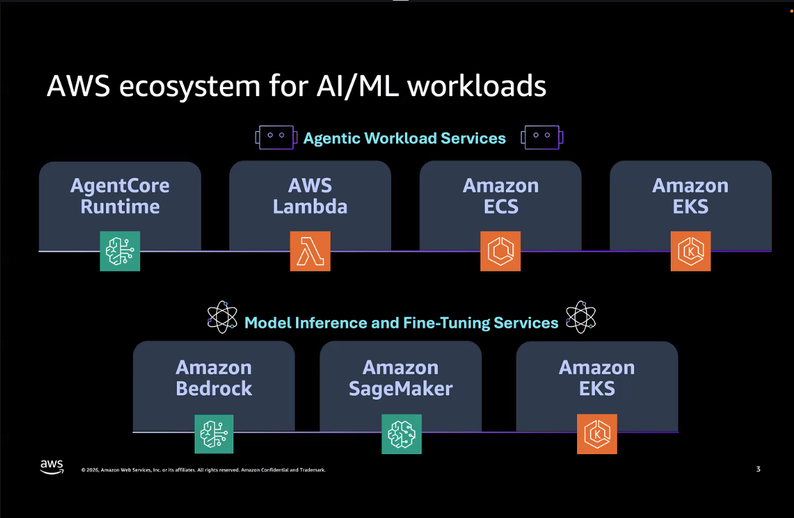

AWS positions **Amazon EKS** on two axes at once: as an **agentic workload runtime** (alongside AgentCore Runtime, Lambda, ECS) and as a **model inference / fine-tuning platform** (alongside Bedrock and SageMaker). The pitch isn't "EKS replaces Bedrock/SageMaker" — it's "use EKS when you specifically need self-hosted control over the serving stack," which is exactly the tradeoff this workshop demonstrates hands-on.

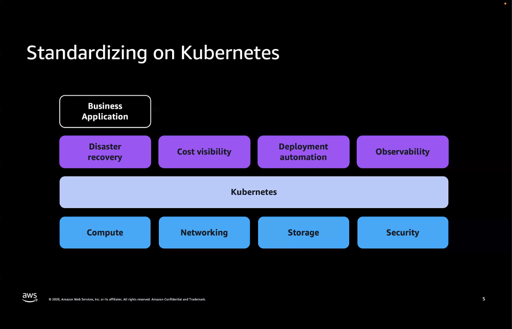

The generic case for Kubernetes as the substrate: one control plane abstraction (compute/networking/storage/security) underneath a consistent operational layer (DR, cost visibility, deployment automation, observability) for any business application — GenAI workloads are just another tenant on that same platform, not a special case requiring separate infrastructure.

## EKS Standard vs. EKS Auto Mode

This is the single most important architectural decision in the whole workshop.

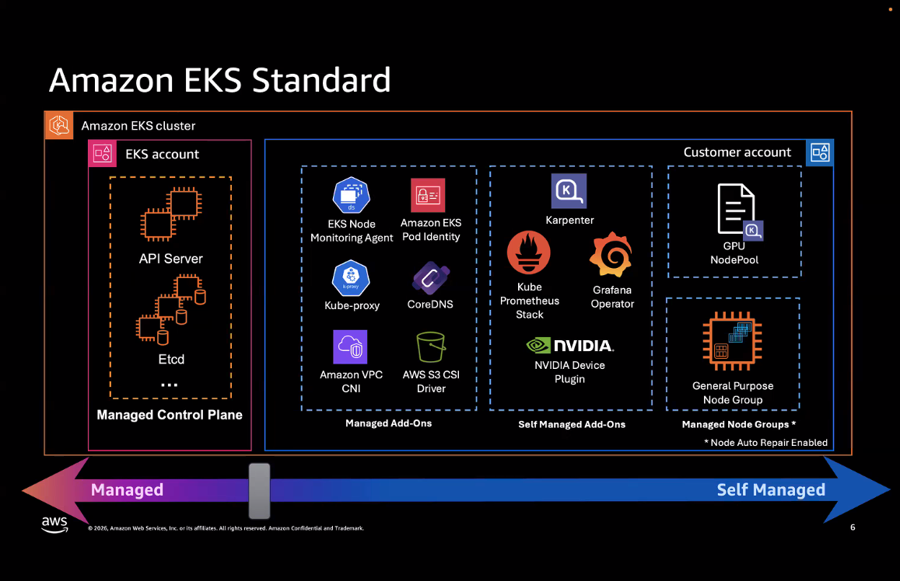

**Standard EKS**: AWS manages the control plane (API server, etcd) and a small set of core add-ons (Node monitoring agent, Pod Identity, kube-proxy, CoreDNS). Everything else — Karpenter, the Prometheus/Grafana stack, the NVIDIA device plugin, and both GPU and general-purpose node groups — is **your** responsibility to install, configure, and keep patched, in **your** account.

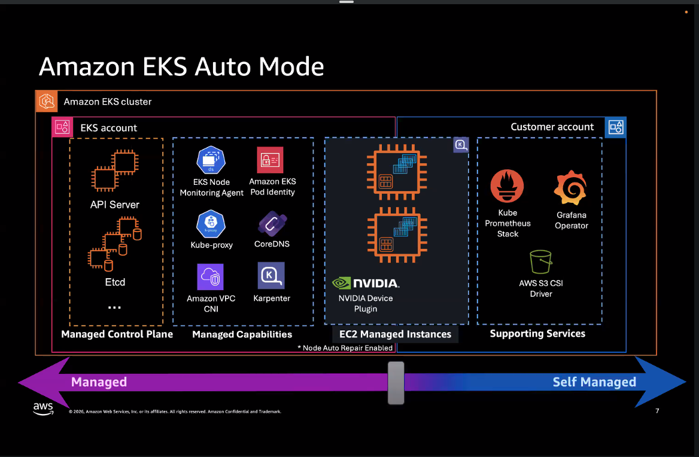

**EKS Auto Mode** (what this workshop actually uses, confirmed live in [`RESEARCH.md` §2](../RESEARCH.md)) moves the line: Karpenter, VPC CNI, CoreDNS, kube-proxy, and — critically — **the NVIDIA device plugin embedded directly in the GPU AMI** all move into the "managed capabilities" / "EC2 managed instances" column. You still own the observability stack (Kube Prometheus Stack, Grafana Operator) and the S3 CSI driver as **self-managed add-ons**, but you never touch Karpenter NodePool internals directly or install a GPU device plugin DaemonSet by hand. This is the mechanism behind the "zero GPU nodes until a pod needs one" behavior verified live: `NODES: 0` on the GPU NodePool before the first `nvidia-smi` test pod was scheduled.

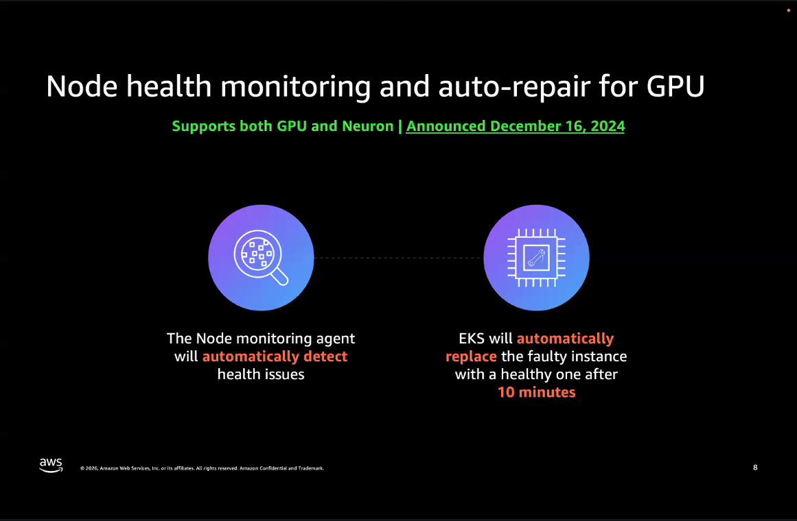

A managed capability that never surfaced directly in the hands-on labs but underpins their reliability: Auto Mode's node monitoring agent detects GPU/Neuron health issues and **auto-replaces a faulty node after 10 minutes**, with no manual intervention. (Announced Dec 16, 2024 — a fairly recent capability.)

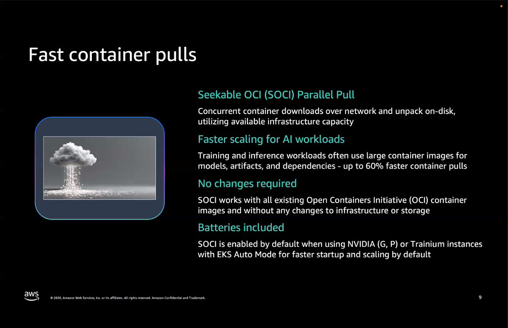

**SOCI (Seekable OCI) parallel pull** is enabled *by default* on GPU/Trainium instances under Auto Mode — no config, no opt-in. This is what made the vLLM container pulls fast enough to be a non-issue throughout the workshop despite multi-GB images; up to 60% faster pulls, using the same local NVMe the custom GPU NodeClass was tuned for (see `RESEARCH.md` §2b).

## Deploying a model: the mental model

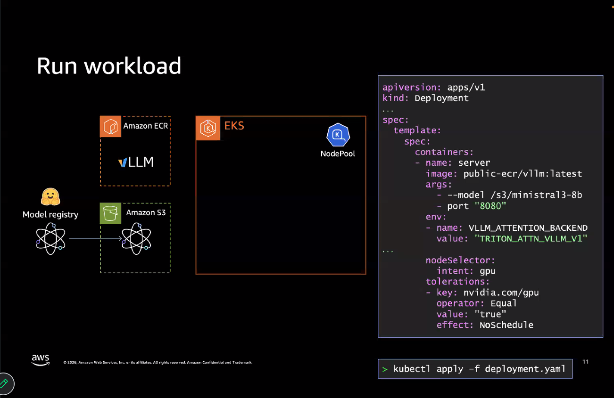

The generic shape AWS presents: a model lands in a **model registry**, gets promoted to **Amazon S3**, and a **Deployment** manifest (built container in ECR + `nodeSelector`/`toleration` for the GPU NodePool) ties the two together. This slide's example YAML (`--model /s3/ministral3-8b`) is a simplified stand-in for the real mechanism the workshop actually used — see the streaming detail below.

### The architecture, built up step by step (the workshop's own progressive-reveal slide)

| Step | Diagram | What's added |
|---|---|---|
| 1–2 | 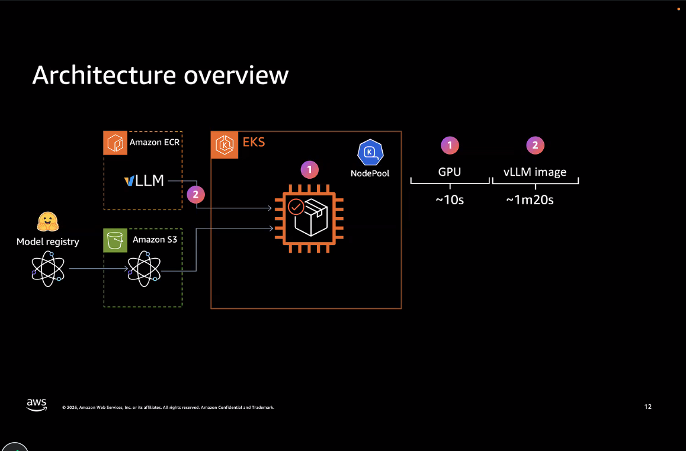 | Provision GPU compute (NodePool) → run the vLLM container from ECR |
| 1–3 | 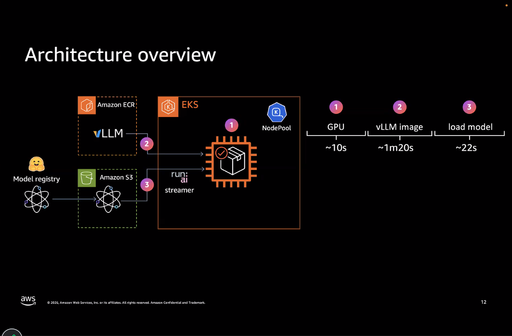 | + **`run:ai` streamer** loads the model from S3 straight into GPU memory. Timings shown: **~10s** GPU provisioning, **~1m20s** image pull, **~22s** model load — this matches what was independently verified live in "Serve a Model": Run:ai Streamer moved 9.7GiB in 7.2s (1.3 GiB/s), full model load in ~27s. |
| 1–3 (labeled) | 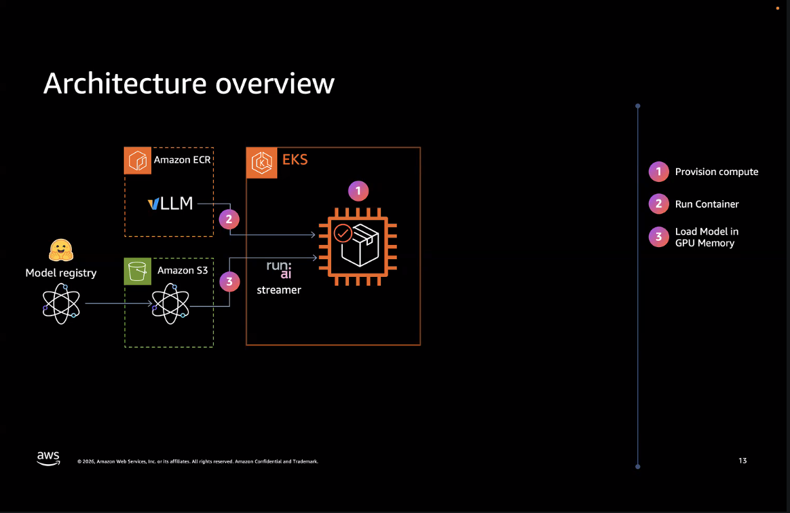 | Same 3 steps, restated as: Provision compute → Run Container → Load Model in GPU Memory |
| 1–4 | 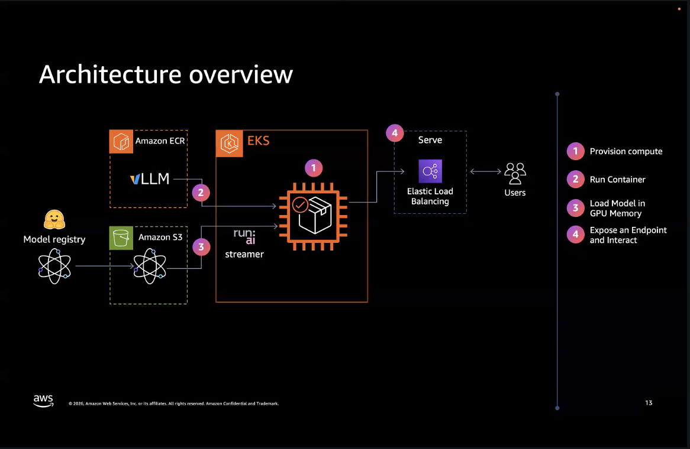 | + **Elastic Load Balancing** exposes an endpoint for **Users** — this is the ALB Ingress pattern used for every externally-exposed service in the workshop (Open WebUI, Grafana, RAG Gradio UI), each governed by the `IngressClassParams.inboundCIDRs` restriction set once in "Setting Up the Cluster." |
| 1–5 | 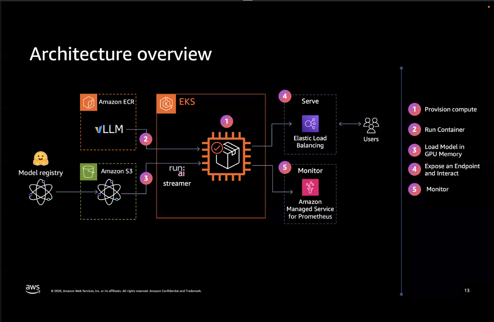 | + **Amazon Managed Service for Prometheus** for monitoring — in the hands-on labs this was the self-managed Kube Prometheus Stack + Grafana Operator instead (see gotcha below on the slide-vs-lab gap). |
| 1–6 | 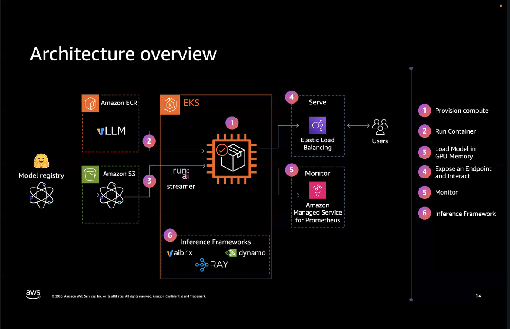 | + **Inference Frameworks** inside EKS: **aibrix**, **dynamo**, **RAY**. The hands-on labs only actually exercised **Ray** (Ray Serve/KubeRay, module "Inference Frameworks") — aibrix and dynamo are named on the slide as part of the broader landscape but weren't hands-on material in this session. |
| 1–7 (complete) |  | + **Agents** — the Strands weather agent from "Optimize Inference," calling the vLLM endpoint's OpenAI-compatible tool-calling API. |

**Gotcha worth flagging explicitly**: the slide deck's "Monitor" step names **Amazon Managed Service for Prometheus** (a fully-managed, remote-write-based metrics backend), but the actual hands-on lab deployed a **self-managed Kube Prometheus Stack + Grafana Operator** instead (confirmed running in the `monitoring` namespace throughout `RESEARCH.md`). Slides describe the idealized/production-recommended architecture; the lab environment substitutes a cheaper, fully-in-cluster stack for workshop purposes. Don't assume the lab's exact resource list *is* the recommended production architecture — cross-check against the slides.

## What the hands-on labs actually built (ground truth)

The diagrams above are the *presenter's* framing. The **actual, verified architecture** from running every module live is documented command-by-command in [`RESEARCH.md`](../RESEARCH.md). Summary:

```
                              ┌─────────────────────────────────────────────┐
                              │              Amazon EKS (Auto Mode)          │
                              │                                               │
  Amazon S3  ──(Run:ai        │  ┌──────────────┐        ┌────────────────┐  │
  (model      streamer,       │  │  GPU NodePool │        │ system/general- │  │
  weights)    or S3 CSI PV)───┼─▶│  g6e.2xlarge  │        │ purpose pools   │  │
                              │  │  1x L40S 46GB │        │ (CPU workloads) │  │
  Amazon      ──(S3 Vectors   │  │  vLLM/Ray     │        └────────────────┘  │
  S3 Vectors    API)──────────┼─▶│  Serve         │                          │
  (RAG index)                 │  └──────────────┘                            │
                              │         │                                    │
  ElastiCache ──(rediss://)───┼─────────┤ (LMCache L2, optional)            │
  Serverless                  │         │                                    │
  Valkey                      │         ▼                                    │
                              │  Kube Prometheus Stack + Grafana Operator     │
                              │  (self-managed add-on)                       │
                              └─────────────────────────────────────────────┘
                                         │
                              ALB Ingress (IngressClassParams-restricted to your IP)
                                         │
                         Open WebUI / Grafana / RAG Gradio UI (users)
```

Three distinct model-loading patterns were exercised across the workshop (see `RESEARCH.md` "Inference Frameworks" for the full contrast):
1. **App-level S3 streaming** (Run:ai Model Streamer) — the default, used by every plain-vLLM deployment.
2. **S3-backed PersistentVolume** via the Mountpoint-for-S3 CSI driver (ROX access mode) — used by Ray Serve and the LoRA-serving attempt.
3. Container-baked weights — not used in this workshop, mentioned for completeness.
